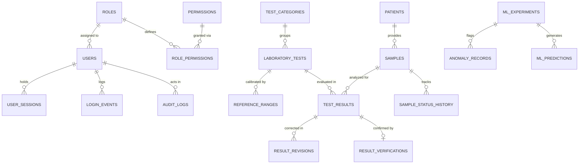

# LabInsight AI — Database Design & Schema Specification

## 1. Relational Topology & Entity Normalization

The LabInsight AI database consists of 29 normalized relational tables within PostgreSQL 16. All entities utilize UUID v4 identifiers to eliminate sequential ID enumeration vulnerabilities (IDOR).

---

## 2. Table Directory (29 Entities)

| Table Name | Description | Key Constraints |
|------------|-------------|-----------------|
| `roles` | System roles (Admin, Tech, Analyst, Researcher) | UNIQUE(name) |
| `permissions` | Fine-grained resource:action privileges | UNIQUE(resource, action) |
| `role_permissions` | Join table associating roles with privileges | Composite PK |
| `users` | User credentials, Argon2id hashes, MFA status | UNIQUE(email), UNIQUE(username) |
| `user_sessions` | Server-managed opaque session records | UNIQUE(session_token_hash) |
| `mfa_credentials` | TOTP secret keys and encrypted backup codes | UNIQUE(user_id) |
| `password_reset_tokens` | Single-use expiring password reset hashes | UNIQUE(token_hash) |
| `login_events` | Authentication attempt logging | Index on (email, occurred_at) |
| `patients` | Pseudonymous patient profiles | UNIQUE(patient_code) |
| `test_categories` | Clinical departments (Haematology, Biochemistry) | UNIQUE(name) |
| `laboratory_tests` | Assays and clinical test definitions | UNIQUE(test_code) |
| `reference_ranges` | Documented normal intervals with clinical provenance | Foreign Key -> `laboratory_tests` |
| `samples` | Specimen intake records and status machine | UNIQUE(sample_code) |
| `sample_status_history` | Immutable chain-of-custody status transitions | Foreign Key -> `samples` |
| `test_results` | Quantitative or qualitative laboratory measurements | Foreign Key -> `samples`, `tests` |
| `result_revisions` | Immutable audit log of all result corrections | Foreign Key -> `test_results` |
| `result_verifications` | Professional supervisor sign-off records | 1-to-1 -> `test_results` |
| `datasets` | Approved internal and synthetic ML datasets | UNIQUE(name) |
| `dataset_versions` | Versioned data snapshots with SHA-256 hashes | Foreign Key -> `datasets` |
| `ml_models` | Machine learning model architecture registry | Index on model_type |
| `ml_model_versions` | Model artifact metadata, parameters & metrics | Foreign Key -> `ml_models` |
| `ml_experiments` | Execution runs for anomaly, cluster & quality jobs | Index on (type, status) |
| `ml_predictions` | Computed model predictions & inference outputs | Foreign Key -> `ml_experiments` |
| `anomaly_records` | Flagged statistical deviations & human reviews | Foreign Key -> `ml_experiments` |
| `data_quality_issues` | Detected format, value or timestamp defects | Foreign Key -> entity_id |
| `reports` | Compiled PDF, CSV, and Excel document metadata | Index on report_type |
| `notifications` | In-app user notifications and alerts | Foreign Key -> `users` |
| `audit_logs` | Tamper-evident immutable operational audit trail | Index on (action, occurred_at) |
| `system_settings` | Administrator-managed application settings | UNIQUE(key) |

---

## 3. Immutable Result Revision Paradigm

To comply with Good Laboratory Practice (GLP) and clinical laboratory quality standards, laboratory results are **never silently overwritten**:
1. When a technician records a test measurement, it starts in `pending` status.
2. A verified result undergoes verification through `result_verifications`.
3. If an error is subsequently identified, the operator must execute a revision via `result_revisions`, supplying:
   - `previous_numeric_value`
   - `new_numeric_value`
   - `reason` (mandatory audit explanation)
   - `revised_by_id` (authorizing user)
   - `revised_at` (server timestamp)
